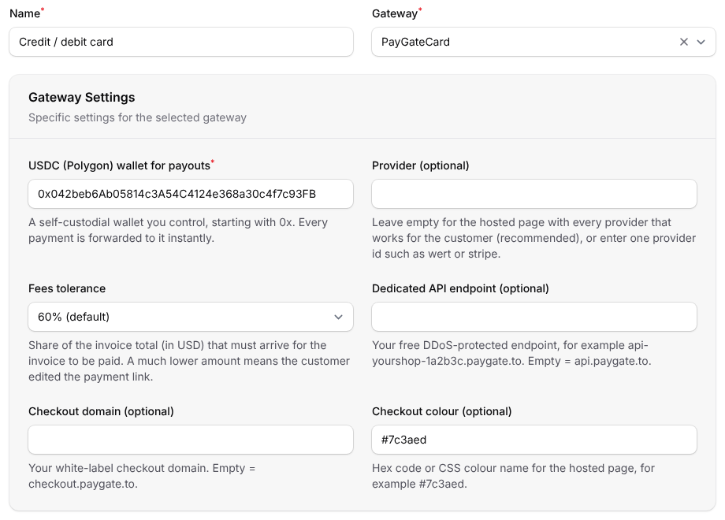
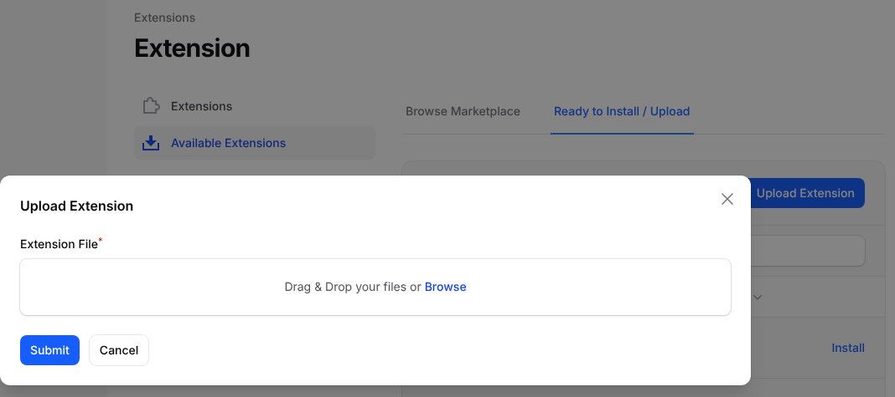
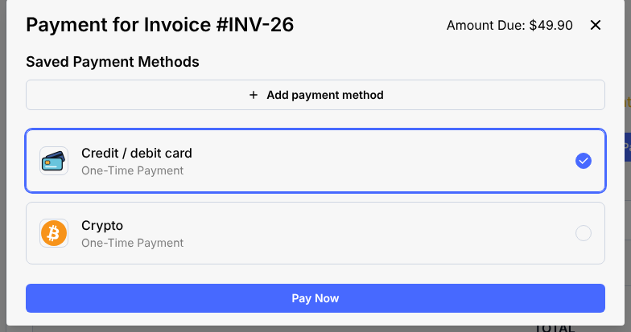
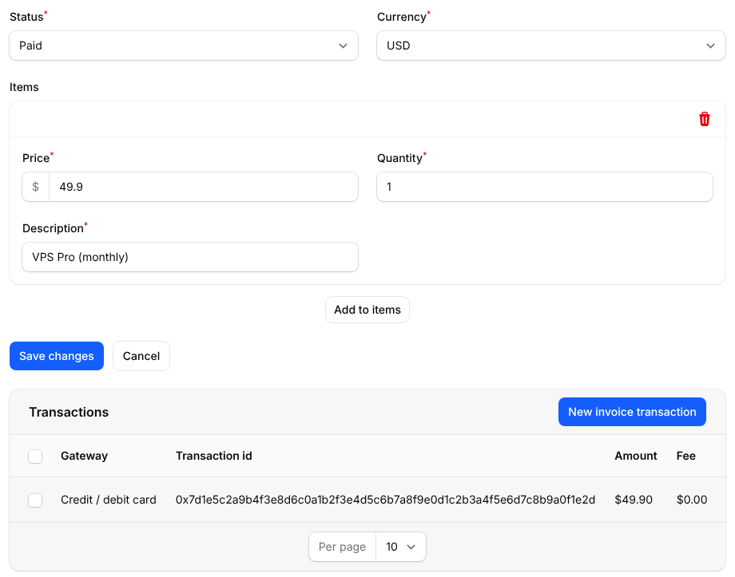

# Instant Payment Gateway Paymenter
Instant Paymenter payment gateway to accept credit or debit cards, Google Pay or Apple Pay. Every payment is paid out instantly to your USDC wallet.

> 🪙 **Want crypto too?** Our free [Paymenter crypto extension](https://github.com/paygate-to/Paymenter-Crypto-Payment-Gateway) is the only crypto payment gateway with instant payouts for Solana, Monero, Zcash and Bitcoin.

## Features

- Accept **Visa, Mastercard, Apple Pay, Google Pay**, SEPA and local bank transfers on your Paymenter invoices.
- **Instant approval**: no sign up, no merchant account, no API keys and no KYC for you.
- **Instant payouts** to your own USDC (Polygon) wallet with every payment.
- **Zero chargebacks**: all payments are final.
- Multi-provider hosted payment page that picks the best provider for each customer's country, or one provider of your choice.
- Installs from the admin area: upload the ZIP under **Extensions**, no server access needed.
- **Secure confirmations**:
  - every payment confirmation is signed by PayGate.to and checked against the bundled public key;
  - every callback URL is signed with your `APP_KEY`;
  - repeated and simultaneous confirmations are credited once;
  - the payout must go to your wallet, and the amount received is compared with the invoice total.
- Works with your own checkout domain and a free dedicated API endpoint ([custom domain guide](https://paygate.to/white-label-api-custom-domain-guide/)).
- Fees: **1% + provider fees**.

📘 **Step-by-step guide:** [https://paygate.to/instant-payment-gateway/paymenter/](https://paygate.to/instant-payment-gateway/paymenter/)



## Requirements

- **Paymenter 1.4 or newer.** Tested on 1.5.9.
- Paymenter must be reachable at its public **https** address, and **Settings › General › App URL** must be that address. Payment confirmations are sent to `https://your-site/extensions/gateways/paygatecard/callback`.
- A USDC (Polygon) wallet address.

## Installation

1. **Get your payout wallet.**
   - Card payments are paid out to a **USDC wallet on Polygon**, an address that starts with `0x`.
   - Payouts may arrive as USDC, USDT (Polygon or BEP-20), ETH or POL; the same address receives all of them.
   - Use a **self-custodial wallet** you control (Trust Wallet, MetaMask, Rabby, a hardware wallet).
   - **Never use an exchange deposit address**, and never paste the USDC token contract address.
2. **Download** [Paymenter-Instant-Payment-Gateway-main.zip](https://github.com/paygate-to/Paymenter-Instant-Payment-Gateway/archive/refs/heads/main.zip). Keep it zipped.
3. **Upload it.** In the Paymenter admin area, go to **Extensions › Available Extensions**, open the **Ready to Install / Upload** tab, click **Upload Extension**, choose the ZIP and click **Submit**. Paymenter installs it as the **PayGateCard** gateway.

   

   <details><summary>No upload button, or uploads are blocked on your server?</summary>

   Unzip the file and copy its contents (`PayGateCard.php` and the `keys` folder) to `extensions/Gateways/PayGateCard/` of your Paymenter installation:

   ```
   Paymenter-Instant-Payment-Gateway-main/     <paymenter>/extensions/Gateways/
   ├── PayGateCard.php       ── copy ──►        └── PayGateCard/
   └── keys/                                        ├── PayGateCard.php
                                                    └── keys/paygate_callback_public_v1.pem
   ```
   </details>

4. **Add the gateway.** Go to **Gateways**, click **New gateway**, enter a **Name** your clients will see (for example "Credit / debit card"), choose **PayGateCard** under **Gateway**, and fill in:

   | Field | What to enter |
   |---|---|
   | USDC (Polygon) wallet for payouts (required) | Your Polygon address (`0x...`) |
   | Provider | Leave empty for the hosted page with every available provider (recommended). Enter a provider id such as `wert` or `stripe` to send clients straight to it ([provider list](https://api.paygate.to/control/provider-status)). |
   | Fees tolerance | Share of the invoice total (in USD) that must arrive for the invoice to be paid. Default 60%, because card providers take their fee from the payment. |
   | Dedicated API endpoint | Optional: your free endpoint, e.g. `api-yourshop-1a2b3c.paygate.to` |
   | Checkout domain, colour | Optional white-label settings for the hosted page |

   Click **Create**.
5. **Test with an invoice.** The client opens the invoice, clicks **Pay**, chooses the card method and clicks **Pay Now**. They are sent to the secure payment page. When the payment is confirmed, the invoice is marked **Paid** automatically.



## Where to see payments

Each payment confirmation becomes a transaction with the blockchain transaction id. You see them under **Invoice › Invoice Transactions** (with their status), on the invoice in the admin area, and on the client's invoice page.

| Transaction | Meaning |
|---|---|
| Status *Succeeded*, the invoice amount | The invoice was paid. |
| Status *Failed*, amount 0 | A payment arrived but did not pay the invoice. The reason is in the Paymenter log (`storage/logs`): *underpaid* (less than your fees tolerance), an unexpected token, a payout that did not go to your wallet, or an *extra payment* on an invoice that was already paid or cancelled. Settle with the client. |

Confirmations that are not genuine, or were changed, are refused and nothing is recorded.

Payouts usually arrive in USDC; when a provider pays out in POL, ETH or BNB, the amount is priced in USD before it is compared.

**Account credit** (Paymenter's *Add credit*) cannot be paid by card: card providers take their fee from the payment, so the full credit would never arrive. Clients can add credit with the crypto gateway.



## Updating

Upload the new ZIP the same way. Paymenter replaces the files and keeps your gateway settings.

## Troubleshooting

- **PayGateCard is not in the Gateway list.** Check that `extensions/Gateways/PayGateCard/PayGateCard.php` exists, then reload the page.
- **The client paid but the invoice is still unpaid.**
  - Look for the invoice under **Invoice › Invoice Transactions**.
  - If there is none, the confirmation could not reach your site. Check that **Settings › General › App URL** is your public https address, and that nothing (maintenance mode, a firewall, IP allow-lists) blocks `/extensions/gateways/paygatecard/callback`.
  - A *Failed* transaction tells you why in `storage/logs`; see the table above.
- **"Payment could not be started".** Check the wallet address. It must be your own Polygon address starting with `0x`.
- **Minimum amounts** vary by provider (about $1 to $30): [see the minimums](https://paygate.to/instant-payment-gateway/#minimumorder).

Full product page: [https://paygate.to/instant-payment-gateway/](https://paygate.to/instant-payment-gateway/) · Support: [Telegram](https://t.me/PayGate_to)
